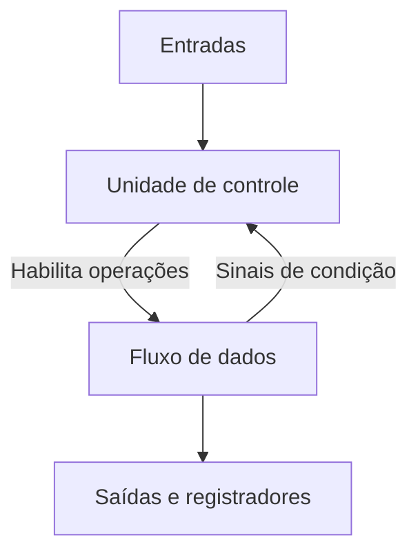
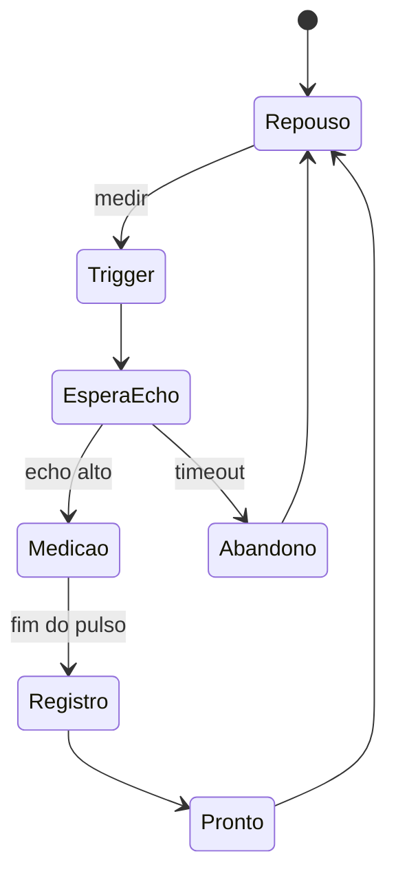
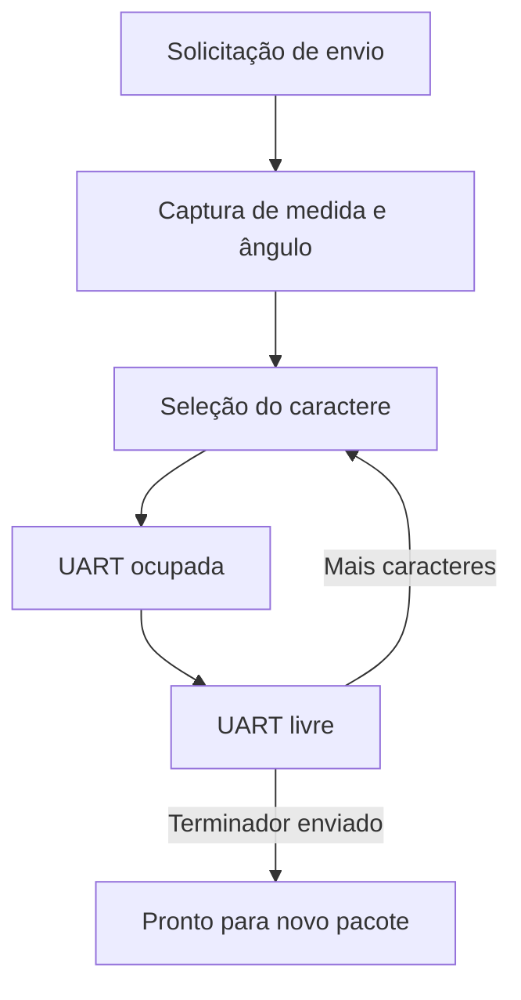
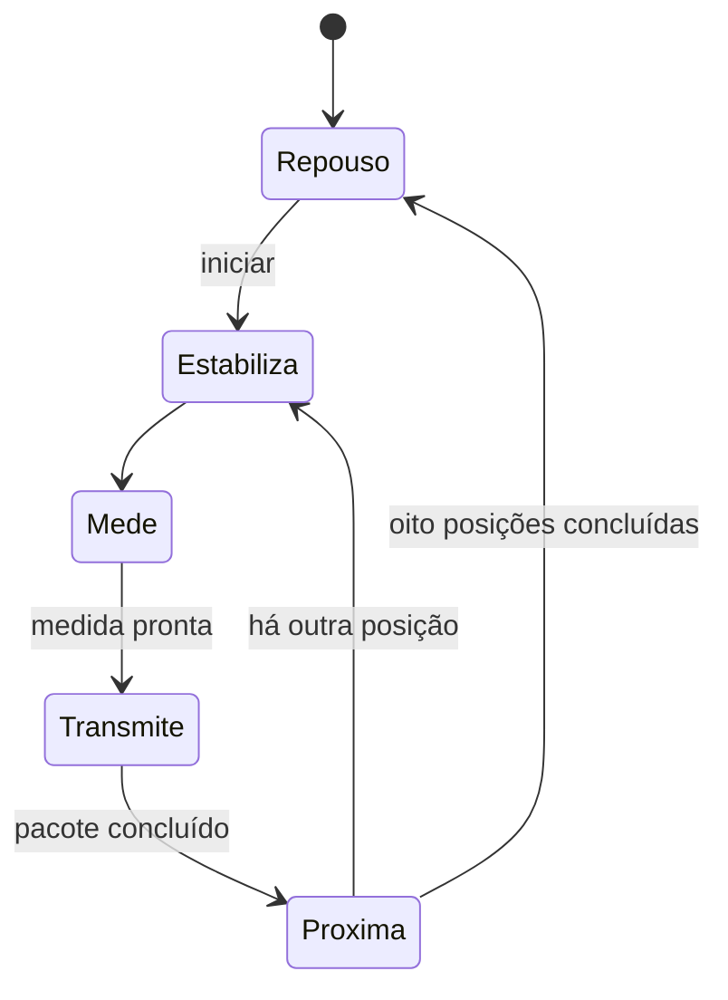

# Diagramas explicativos desta edição

Os diagramas abaixo foram produzidos para explicar as implementações organizadas. Substituem a função didática das capturas históricas sem reproduzir dados pessoais ou imagens dos documentos originais.

## Controle e fluxo de dados

**Objetivo pedagógico:** distinguir decisões de sequenciamento das operações que transformam ou armazenam valores. Uma transição de estado só tem significado quando se identifica qual registro será atualizado e em qual borda.

## Aquisição ultrassônica

**Objetivo pedagógico:** explicar a diferença entre ausência de resposta, duração da resposta e disponibilidade do resultado. O registrador da medida final deve reter o valor concluído enquanto a próxima aquisição é preparada.

## Pacote consistente durante a transmissão

**Objetivo pedagógico:** perceber que um pacote demora vários ciclos para sair. Alterar a entrada no meio do envio não pode produzir metade de uma medição antiga e metade de uma medição nova. O teste `tb_telemetria` verifica essa propriedade.

## Formato UART 7E1

| Ordem | Campo | Interpretação |
| --- | --- | --- |
| 1 | Start | Nível baixo inicia o quadro |
| 2–8 | Dados | Sete bits, do menos significativo ao mais significativo |
| 9 | Paridade | XOR dos sete dados para obter quantidade par de bits altos |
| 10 | Stop | Nível alto encerra o quadro |

**Objetivo pedagógico:** seguir um caractere desde o código ASCII até os níveis transmitidos. O teste `tb_uart` verifica todos os 128 caracteres e o reset durante a transmissão.

## Sonar

**Objetivo pedagógico:** coordenar tempo mecânico, aquisição e comunicação. A simulação integrada usa um sensor comportamental e verifica a ordem de oito ângulos. A montagem real exige calibração do servo e conferência elétrica.
