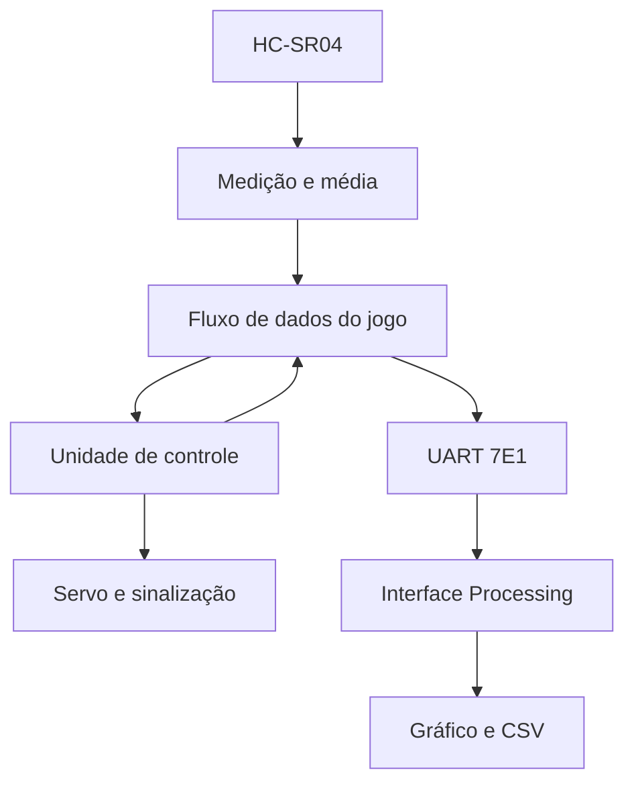

# Guardião do Paredão

[Início](../../README.md) · [Como executar](../../README.md#como-executar) · [Aprendizagem](../../README.md#o-que-desenvolvi-e-aprendi) · [Estado atual](../../README.md#estado-atual)

> **Nesta área:** jogo de avançar/parar, com sensor, servo, UART e interface Processing; simulação e bancada têm verificações distintas.

[Início](../../README.md) · [Como executar](../../README.md#como-executar) · [Aprendizagem](../../README.md#o-que-desenvolvi-e-aprendi) · [Estado atual](../../README.md#estado-atual)

> **Nesta área:** jogo de avançar/parar, com sensor, servo, UART e interface Processing; simulação e bancada têm verificações distintas.

Jogo físico de avançar e parar, implementado com FPGA, sensor ultrassônico, servomotor e interface no computador. O guardião alterna a indicação para movimento e espera. O circuito mede a posição, avalia o deslocamento e transmite dados da rodada.

## Objetivos pedagógicos

**Para o jogador:** praticar atenção aos sinais, compreensão de regras, espera e regulação do movimento. A proposta oferece feedback visual e espacial. Os relatórios discutem adaptação da sinalização para crianças com TEA, incluindo a opção de desativar luzes. Esses objetivos expressam a intenção do projeto e não constituem comprovação terapêutica.

**Para quem desenvolve:** integrar máquinas de estados, medição de tempo de voo, filtragem de amostras, PWM e UART. O objetivo é compreender como uma decisão do jogo depende da qualidade do dado do sensor e da coerência entre FPGA e interface.

## Arquitetura

## Materiais

| Caminho | Conteúdo |
| --- | --- |
| `rtl/guardiao/` | Integração, controle e fluxo de dados |
| `rtl/medidor_distancia/` | Interface ultrassônica, contadores, média e conversores |
| `rtl/transmissor/` | Formatação ASCII e UART |
| `processing/Guardiao/Guardiao.pde` | Sketch recuperado do documento Código do processing |
| [Semana final](../../docs/ACERVO.md) | QARs e fontes originais |
| [Acervo LabDig II](../../docs/ACERVO.md) | Relatório final, vídeo e demais versões |

## Interface sem placa

Abra `processing/Guardiao/Guardiao.pde` no Processing, em modo Java, com a biblioteca Serial disponível. A variável `usarSimulacao` vem como `true`. Execute o sketch.

| Tecla | Função |
| --- | --- |
| `0` | Simulação normal |
| `1` | Roteiro de vitória |
| `2` | Roteiro de derrota |
| `J` | Reiniciar a interface/simulação |
| `X` | Ativar/desativar registro CSV |
| `S` | Salvar snapshot do histórico |

O código é uma recuperação do documento original. A adaptação Java foi compilada com bibliotecas reais; a lógica e a interface Java2D foram testadas, incluindo display virtual, vitória/derrota e exportação. A porta serial física continua sem ensaio nesta edição. Consulte a validação na raiz antes de usar em bancada.

## Interface com FPGA

Configure `usarSimulacao = false`, substitua a porta `COM7` pela porta real do computador e confira o baud rate. O sketch usa **115200, 7 bits, paridade par e 1 stop bit**. Veja o [protocolo](PROTOCOLO.md) e o [guia de bancada](../../docs/HARDWARE.md).

## Validação

Execute `python scripts/verificar.py` na raiz. O RTL integrado compila e os testes cobrem conversões, diferença de posição, formatação, quadros UART e decisões da unidade de controle. As correções estão em [CORRECOES.md](../../docs/CORRECOES.md).

Ainda exigem ensaio: pinagem, níveis elétricos, montagem, ruído do sensor, temporização física do servo, tratamento de falhas persistentes e sincronização com a aplicação. O circuito repete a aquisição quando todas as amostras falham; não possui, nessa versão, limite global de tentativas. Os displays de medida declarados no fluxo de dados não são usados pelo top-level selecionado.

## Atividade pedagógica sugerida

Peça ao aluno que explique uma derrota possível e identifique sua causa: movimento real, tolerância inadequada ou erro de medição. Depois, compare uma rodada com e sem ruído simulado. O exercício conecta a regra do jogo à responsabilidade de validar um sistema que interage com pessoas.

---

**Projeto:** [Laboratório Digital I e II · Circuitos, jogos e FPGA](../../README.md). Consulte a raiz para os requisitos e o primeiro comando; este guia aprofunda a área `projetos/guardiao-do-paredao/`.

---

**Projeto:** [Laboratório Digital I e II · Circuitos, jogos e FPGA](../../README.md). Consulte a raiz para os requisitos e o primeiro comando; este guia aprofunda a área `projetos/guardiao-do-paredao/`.
