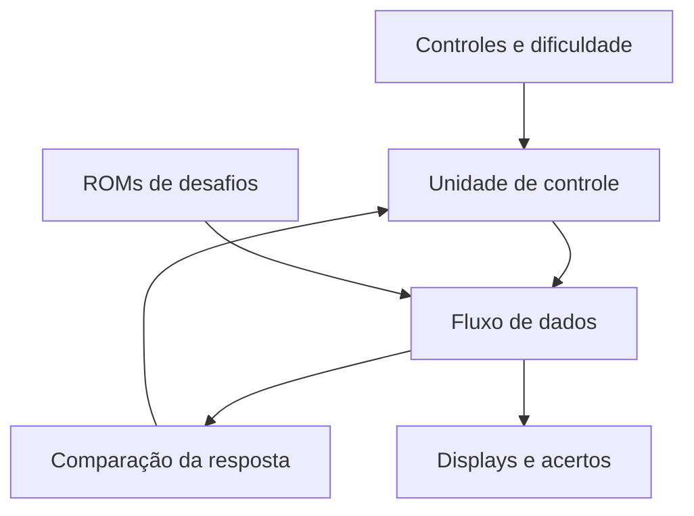

# Math Genius

Jogo de desafios aritméticos em FPGA. ROMs armazenam operações, os controles físicos permitem construir uma resposta e a unidade de controle coordena a seleção de dificuldade, a confirmação e o feedback.

## Objetivos pedagógicos

**Para o jogador:** exercitar cálculo, atenção ao operador e revisão da resposta em desafios com dificuldade selecionável. A proposta de serious game foi pensada no contexto de participação de crianças com TEA. Seu efeito educacional ainda exige avaliação com participantes.

**Para o estudante de engenharia:** representar operações em ROM, multiplexar displays, tratar pulsos de botões, comparar respostas e separar controle de processamento. A aprendizagem pode ser demonstrada seguindo uma operação desde a ROM até a indicação de acerto.

## Arquitetura

## Código e versões

- `rtl/MathGenius.v`: integração do projeto.
- `rtl/unidade_controle.v`: sequência de estados.
- `rtl/fluxo_dados.v`: desafios, resposta e comparação.
- `rtl/componentes/`: ROMs, controles e decodificadores.
- [Projeto histórico e QARs](../../docs/ACERVO.md).
- [Relato geral](../../docs/ACERVO.md), com justificativa pedagógica e descrição do grupo.

A cópia de trabalho parte da versão `OL25/03/Semana3VerilogA6`. A pasta `PROJETO` contém vários QARs posteriores; sua precedência e conteúdo não foram presumidos apenas pelo nome do arquivo. O fechamento da versão de hardware exige restaurá-los no Quartus e comparar suas revisões.

## Executar e verificar

Execute `python scripts/verificar.py` na raiz. O alvo `math-genius` confirma a compilação de `MathGenius` com seus componentes. Não há teste automatizado completo de uma partida nesta edição. Os testbenches históricos estão no acervo.

Para a placa, restaure um QAR em diretório separado e confira a pinagem e os periféricos. As correções de barramentos e displays estão descritas em [CORRECOES.md](../../docs/CORRECOES.md).

## Perguntas de aprendizagem

- Como cada ROM representa os operandos e a operação?
- Quando uma mudança de dificuldade pode alterar a rodada?
- Qual é a faixa numérica dos registradores e o que acontece em uma operação fora dessa faixa?
- O feedback permite revisar a estratégia ou apenas informa acerto e erro?
